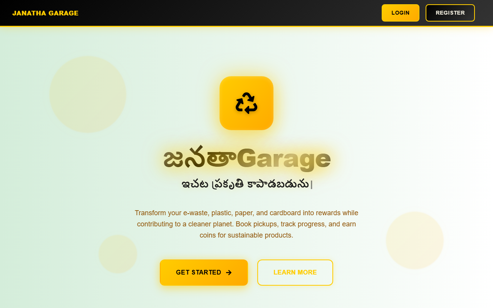
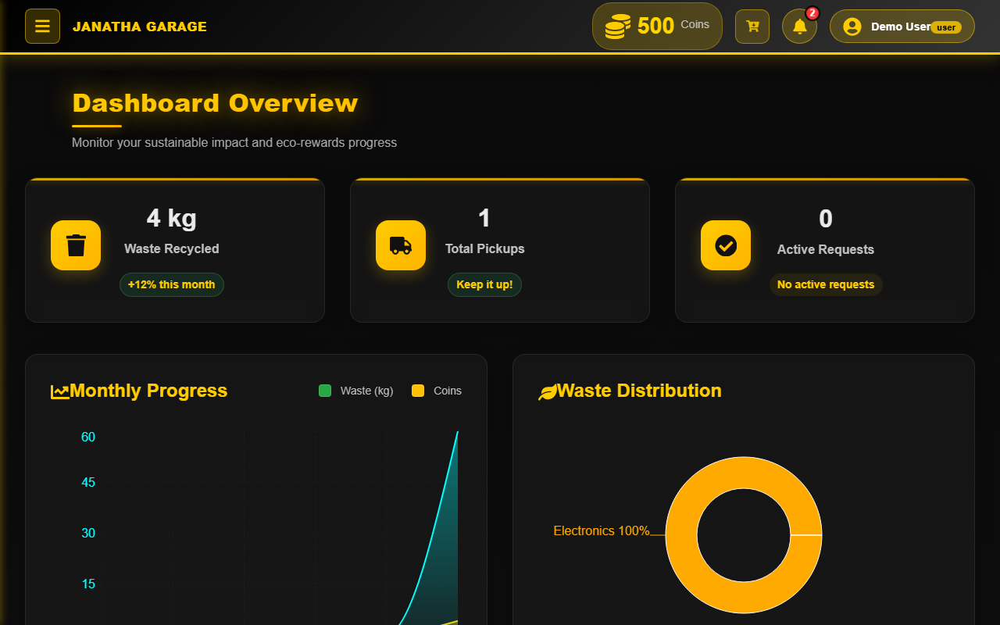
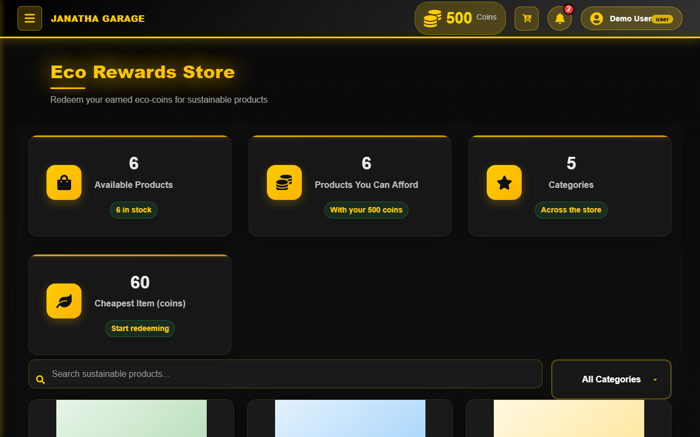
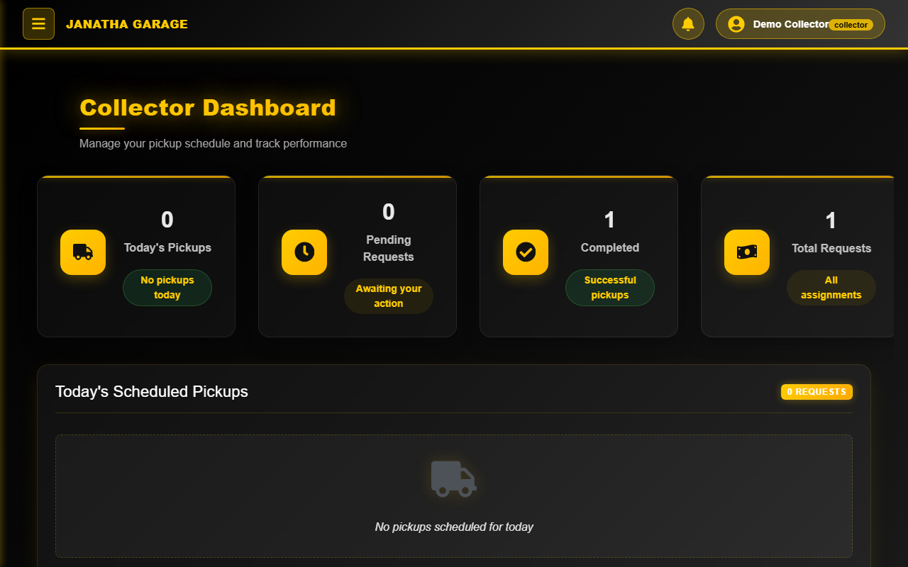
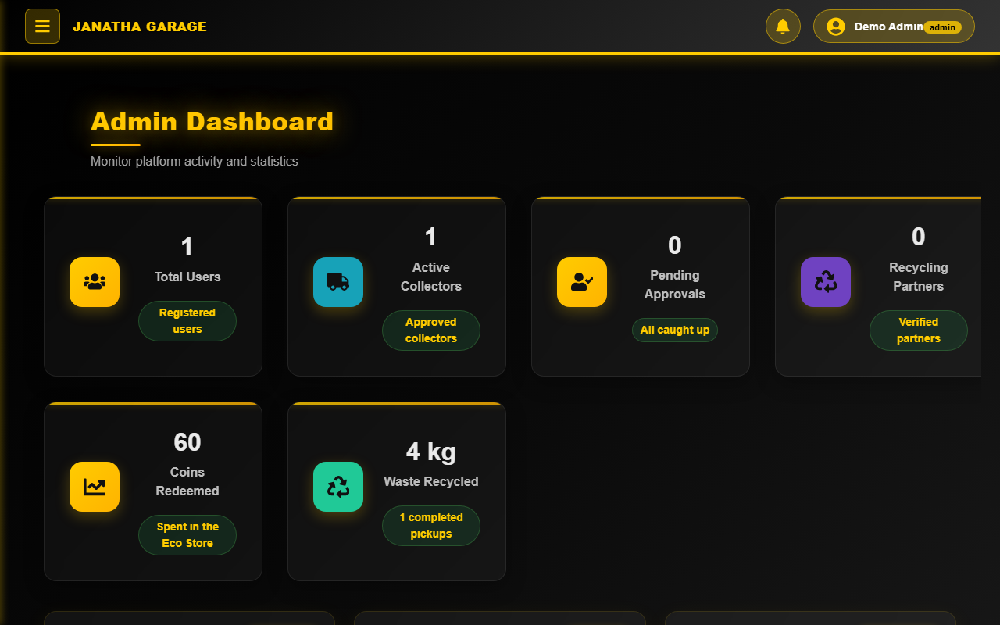

# 🧩 Janatha Garage – Turning Trash into Treasure

A **Smart E-Waste Collection & Rewards Platform** that connects users, collectors, and admins to promote sustainable waste management through an efficient, tech-driven approach.

---

## 🧠 Problem Statement

Improper e-waste disposal remains a major challenge due to a lack of organized collection systems and incentives.

### 💡 Our Solution
Janatha Garage provides a digital platform where:

- Users can request e-waste pickups.  
- Collectors are approved by the admin to handle and deliver waste to verified recycling centers.  
- Users earn reward coins that can be redeemed for eco-friendly products or services.  
- Collectors gain part-time employment, and admins oversee operations and rewards.  

---

## 🌱 Why It Matters

- Tackles unmanaged e-waste and plastic pollution.  
- Transforms waste into value through recycling and reward systems.  
- Empowers communities to take part in sustainability efforts.  
- Promotes transparency and accountability in waste management.  
- Contributes to a **cleaner, greener, and more responsible future.**

---

## ⚙️ Key Features

### 🧍 User Dashboard
- Book waste pickups easily.  
- Track real-time collection status.  
- Earn and redeem reward coins.  
- View pickup and reward history.  

### 🧺 Collector Dashboard
- Accept and manage pickup requests.  
- Submit collected waste to verified recycling centers.  
- Track daily collections and earnings.  

### 🛠️ Admin Dashboard
- Manage users, collectors, and recycling centers.  
- Monitor all waste collection activities.  
- Approve collector registrations and verify submissions.  
- Oversee rewards, data, and platform performance.  

---

## 🧰 Tech Stack

| **Area** | **Technology** |
|-----------|----------------|
| **Frontend** | React + Vite + TypeScript |
| **Backend** | Node.js + Express.js |
| **Database** | MongoDB |
| **Authentication** | JWT (JSON Web Token) |
| **Architecture** | Client–Server Model with real-time updates and role-based dashboards |

---

## 🌍 Impact

- **Cleaner Cities:** Organized collection reduces pollution.  
- **Motivated Citizens:** Rewards inspire consistent recycling.  
- **Transparency:** Real-time tracking ensures accountability.  

---

## 🚀 Scalability & Future Enhancements

- **AI-Based Route Optimization:** Efficient pathfinding for collectors.  
- **Municipal Integration:** Connects with government systems for waste tracking.  
- **Gamification:** Leaderboards, badges, and milestones to encourage engagement.  
- **Mobile App Version:** Real-time notifications and seamless access.  
- **AI Insights:** Predictive analytics for waste patterns and optimization.  

---

## 👥 Team Janatha Garage

| **Name** | **Role** |
|-----------|-----------|
| **KSV Thanush** | Data and API Integration |
| **Rajala Sasank Reddy** | Team Lead |
| **Ashok Yekkanti** | Frontend Developer |
| **Venkatesh Budhi** | Frontend Developer |
| **Anand Peyala** | Backend Developer |

> _“United by collaboration and purpose, our team lives by its motto — a people’s workshop working toward a sustainable tomorrow.”_

---

## 📸 Screenshots

| Home | User dashboard |
|---|---|
|  |  |
| **Eco Store** | **Collector dashboard** |
|  |  |
| **Admin dashboard** | |
|  | |

---

## ⚙️ Setup Instructions

You need **Node.js 20.19+ (or 22.12+)**, **npm**, and a **MongoDB** database (a free MongoDB Atlas cluster or a local `mongodb://localhost:27017`).

### 1️⃣ Clone the repository

```bash
git clone https://github.com/AravindReddy718/GreenCollect.git
cd GreenCollect
```

### 2️⃣ Backend

```bash
cd backend
npm install
cp .env.example .env
```

Edit `backend/.env`:

| Variable | Required | Description |
|---|---|---|
| `MONGO_URI` | Yes | MongoDB connection string |
| `JWT_SECRET` | Yes | Long random string used to sign login tokens. The server will not start without it. |
| `JWT_EXPIRES_IN` | No | Token lifetime, default `7d` |
| `PORT` | No | Default `4000` |
| `FRONTEND_URL` | No | Frontend address: allowed for CORS and used in password-reset links (default `http://localhost:5173`) |
| `CLOUDINARY_CLOUD_NAME`, `CLOUDINARY_API_KEY`, `CLOUDINARY_API_SECRET` | Only for product image uploads | Cloudinary account keys |
| `SMTP_HOST`, `SMTP_PORT`, `SMTP_USER`, `SMTP_PASS`, `MAIL_FROM` | Only to email password-reset links | Any SMTP provider (e.g. Gmail with an App Password, Brevo, SendGrid) |

Create an admin and load the demo data, then start the server:

```bash
npm run create-admin -- admin@demo.com DemoAdmin@123 "Demo Admin"
npm run seed
npm run dev
```

Check it is running: open http://localhost:4000/api/health

### 3️⃣ Frontend

In a second terminal:

```bash
cd frontend
npm install
cp .env.example .env      # VITE_API_URL=http://localhost:4000
npm run dev
```

Open http://localhost:5173

### 🔑 Forgot password

Click **Forgot Password?** on the login page and enter your email. A single-use reset link (valid for 30 minutes) is emailed to you; after a reset, every device that was signed in is signed out.

Without SMTP settings, the backend prints the email (including the link) in its terminal instead, so the flow can be tried locally without an email account. In development the link is also printed in the backend terminal after the email is sent, and if sending fails (for example wrong SMTP login) the backend explains why and still prints the link. Set `NODE_ENV=production` on a real server so links are never printed.

**Using Gmail:** turn on 2-Step Verification for the account, create an [App Password](https://myaccount.google.com/apppasswords), and put your real Gmail address in `SMTP_USER` and the 16-character App Password in `SMTP_PASS`. Your normal Gmail password is rejected (`535 Username and Password not accepted`).

### 4️⃣ Demo accounts

| Role | Email | Password |
|---|---|---|
| Admin | admin@demo.com | DemoAdmin@123 |
| User | user@demo.com | DemoUser@123 |
| Collector | collector@demo.com | DemoCollector@123 |

The demo user starts with 500 coins, there are 6 products in the store, and one pending pickup request for the collector to accept.

### 5️⃣ Run the backend tests

```bash
cd backend
npm test
```

The tests use a temporary in-memory MongoDB, so they never touch your real database.

### 🧠 Troubleshooting

- **"JWT_SECRET must be set"**: add `JWT_SECRET` to `backend/.env`.
- **"Cannot connect to server" on login**: the backend is not running, or `VITE_API_URL` in `frontend/.env` points to the wrong address.
- **Port already in use**: stop the other process with **Ctrl + C**, then run `npm run dev` again.
